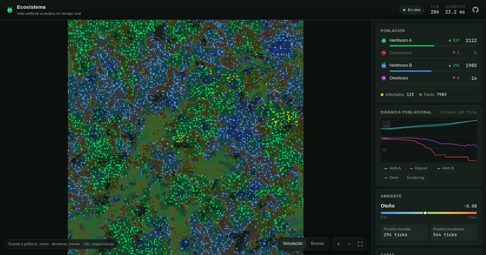
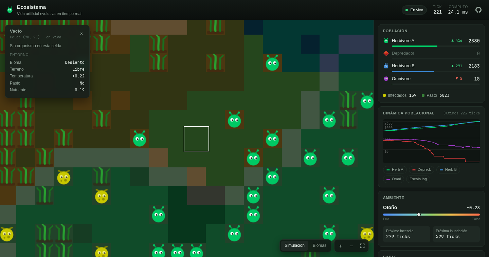

# Ecosistema — simulación de vida artificial

Ecosistema evolutivo en tiempo real sobre un grid de 200×200: dos herbívoros que compiten por el pasto,
un depredador y un omnívoro, cada uno con un **genoma heredable** que evoluciona por selección natural.
El servidor (Python + NumPy) aplica las reglas en cada tick y transmite el estado por WebSocket a un
cliente Canvas sin dependencias.



## Características

- **Selección natural emergente.** Cinco genes por organismo (velocidad, umbral reproductivo, eficiencia
  alimentaria, visión y tasa de mutación). Reproducción sexual con crossover uniforme y mutación.
- **Cadena trófica.** Pasto → herbívoros → omnívoro → depredador, con caza dirigida por visión y rastreo
  de feromonas. Ciclos depredador-presa visibles en la gráfica de población.
- **Ambiente dinámico.** Biomas con nichos distintos, terreno (agua, roca, pantano), estaciones que
  modulan temperatura, movimiento y reproducción, difusión de nutrientes, incendios e inundaciones.
- **Comportamiento colectivo.** Feromonas, cardumen (cohesión y separación) y territorio.
- **Epidemiología.** Infección por contacto con drenaje de energía, recuperación y transmisión a las crías.
- **Migración (efecto rescate).** Si una especie se extingue, tras un tiempo llega un grupo fundador:
  la demo pública nunca se queda vacía.
- **Cliente interactivo.** Zoom y desplazamiento (ratón, táctil y teclado), inspector de celda con
  actualización en vivo, capas activables, gráfica con tooltip y escala logarítmica, y registro de eventos
  con "ir al lugar".



## Arquitectura

```
┌──────────────────────────── server.py (asyncio) ────────────────────────────┐
│  loop por deadline a SIM_FPS                                                │
│   └─ asyncio.to_thread ─► simulation.tick(state) ─► build_render(state)      │
│        (NumPy libera el GIL; el event loop sigue atendiendo clientes)       │
│   └─ broadcast: stats JSON + frame binario (1 byte por celda = 40 KB)       │
└────────────────────────────────────┬────────────────────────────────────────┘
                                     │ WebSocket (permessage-deflate)
┌────────────────────────────────────▼─────────── client.js ──────────────────┐
│  zoom bajo:  LUT Uint32 → ImageData 200×200 → 1 drawImage escalado           │
│  zoom alto:  overlays en ImageData + sprites SVG pre-rasterizados (solo      │
│              las celdas visibles)                                           │
└─────────────────────────────────────────────────────────────────────────────┘
```

El estado es un diccionario de arrays paralelos (`species`, `energy`, `age`, `genome[y, x, 5]`, …).
Cada regla de `rules/` es una función pura `apply(state) -> state` y `simulation.RULES` define su orden.
`rules/common.py` concentra las operaciones que deben mantener sincronizadas todas las capas de un
organismo (`move`, `kill`, `pay_and_starve`), de modo que ningún dato quede huérfano en una celda vacía.

## Rendimiento

Medido con `python scripts/benchmark.py 300` (grid 200×200, ~4.000–5.000 organismos):

| Etapa                   | Antes      | Ahora   | Cambio clave                                                    |
|-------------------------|-----------:|--------:|-----------------------------------------------------------------|
| Reproducción            | 113 ms     | 2,4 ms  | búsqueda de pareja solo sobre los individuos fértiles, no sobre todo el grid |
| Cardumen                | 11,3 ms    | 5,1 ms  | slicing sobre un array con padding en vez de 256 `np.roll`       |
| **Tick completo**       | **139 ms** | **~21 ms** | **6,7× más rápido**                                          |
| Render del frame        | 7,6 ms     | 2,3 ms  | `np.maximum` encadenado en lugar de `max(axis=2)`, bordes precalculados |
| Estadísticas            | 4,4 ms     | 1,8 ms  | ídem                                                            |
| Cliente (zoom 1)        | hasta 40.000 `drawImage` | 2 `drawImage` | rasterizado por LUT en `ImageData`                   |

El tick y el render corren fuera del event loop, así que conectar clientes o inspeccionar celdas no
compite con la simulación.

## Ejecutar en local

Requiere Python 3.10+.

```bash
python -m venv .venv && source .venv/bin/activate
pip install -r requirements-dev.txt

python server.py                  # WebSocket en ws://localhost:8765
python -m http.server 8000        # en otra terminal; abre http://localhost:8000
```

Con Docker:

```bash
docker compose up --build         # http://localhost:8080
```

### Variables de entorno del servidor

| Variable   | Por defecto | Descripción                                |
|------------|-------------|--------------------------------------------|
| `SIM_FPS`  | `4`         | Ticks por segundo                          |
| `SIM_PORT` | `8765`      | Puerto del WebSocket                       |
| `SIM_HOST` | `0.0.0.0`   | Interfaz de escucha                        |
| `SIM_SEED` | —           | Semilla para reproducir un mundo concreto  |

El cliente se conecta a `ws://<host>:8765` (o a `wss://<host>/ws` bajo HTTPS); `?ws=<url>` permite apuntar
a otro servidor.

## Tests y benchmark

```bash
python -m pytest -q               # invariantes del estado y reglas individuales
python scripts/benchmark.py 300   # costo por regla
```

Los tests cubren, entre otros, que ninguna capa deje datos en celdas vacías, que la edad y la infección
viajen con el organismo al moverse, el emparejamiento por género y por radio de cada especie, y la migración.

## Estructura

```
config.py            parámetros y registro de especies (fuente única para servidor y cliente)
simulation.py        estado inicial, orden de reglas y render del frame
server.py            servidor WebSocket
rules/               una regla por archivo (+ common.py, hunting.py compartidos)
client.js            render Canvas, interacción y paneles
index.html, styles.css
tests/               pytest
scripts/benchmark.py
```

## Licencia

MIT — ver [LICENSE](LICENSE).
